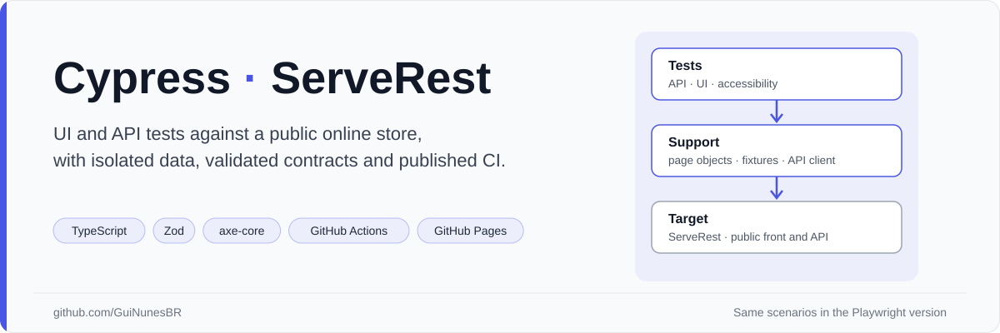
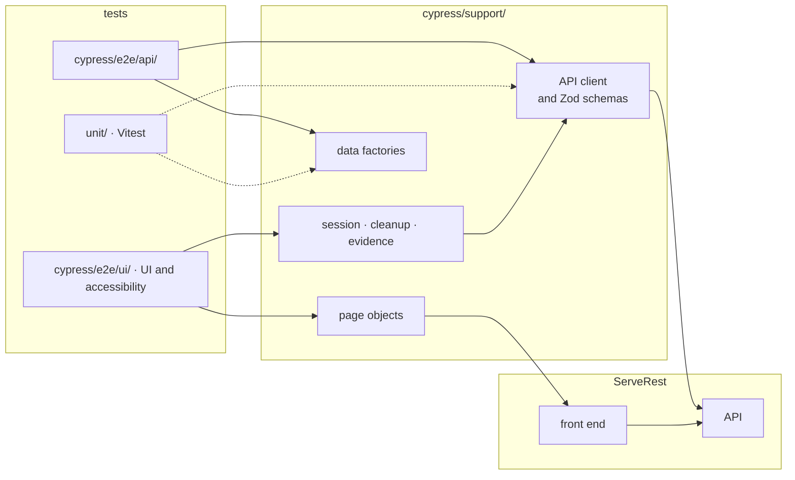
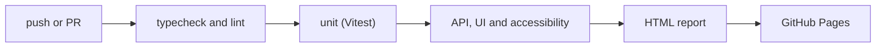

# Cypress + TypeScript · ServeRest

<p align="center"></p>

[](https://github.com/GuiNunesBR/cypress-serverest-e2e/actions/workflows/tests.yml)
[](https://github.com/GuiNunesBR/cypress-serverest-e2e/blob/main/package.json)
[](https://github.com/GuiNunesBR/cypress-serverest-e2e/blob/main/tsconfig.json)
[](https://github.com/GuiNunesBR/cypress-serverest-e2e/blob/main/package.json)
[](https://github.com/GuiNunesBR/cypress-serverest-e2e/blob/main/LICENSE)

[Português](README.md) · **English**

**UI and API tests in Cypress against a public online store: the tests create and delete their own data, validate the contracts of the responses and leave evidence in the published report.**

An **end-to-end (UI) and API** test suite in **Cypress + TypeScript** against [ServeRest](https://serverest.dev), a public online store built for practising test automation.

It is the Cypress version of [playwright-serverest-e2e](https://github.com/GuiNunesBR/playwright-serverest-e2e): **same scenarios, same data, same contracts**, to compare the two tools side by side. The comparison is at the end of this file.

The test names, comments and report steps are in Portuguese, like the app under test.

## Architecture



In CI (GitHub Actions), every push goes through these steps; on `main`, the report is published to GitHub Pages:



## What is tested

| Layer | Coverage |
|---|---|
| **API** | users (sign-up, duplicates, required fields, lookup, update, deletion, and deletion blocked by a cart), login (valid, wrong password, unknown email), products (CRUD, token, duplicates, invalid price, filter, deletion blocked by a cart), cart (checkout, stock reserved and given back on cancellation, insufficient stock, one cart per user) |
| **UI · admin** | login (success, error and logout), user sign-up through the public page and the admin panel, required sign-up fields, product creation and deletion |
| **UI · customer** | product search in the store, a search with no results, and building the shopping list (quantity and price) |
| **Accessibility** | 9 pages audited with axe-core (WCAG 2.1 A and AA), against a baseline of known issues |
| **Contract** | every relevant API response is validated with [Zod](https://zod.dev) schemas |
| **Unit** | data factories, schemas and the list of audited pages, with [Vitest](https://vitest.dev), no browser and no network |

There are **59 tests**: 15 unit tests (Vitest) and 44 in Cypress (24 API, 11 UI and 9 accessibility). The most important scenarios are tagged `@smoke` (`npm run test:smoke`) and the accessibility ones `@a11y` (`npm run test:a11y`).

## Running

Requires Node 22 or later.

```bash
npm ci
npx cypress install   # downloads the Cypress binary, if npm didn't
npm test              # API and UI in Cypress, with the report in cypress/reports/html
npm run test:unit     # unit only (Vitest, no browser, no network)
npm run test:api      # API only
npm run test:ui       # UI only
npm run test:smoke    # @smoke scenarios only
npm run test:a11y     # accessibility only
npm run open          # interactive mode
npm run lint          # checks the layers (who may import what)
```

To target another environment, copy `.env.example` to `.env` and set `FRONT_URL` and `API_URL`.

## Evidence in the report

The report is generated by [cypress-mochawesome-reporter](https://github.com/LironEr/cypress-mochawesome-reporter) as a single HTML file (screenshots embedded):

- **API calls.** Every call made by the test goes into the test context (`API POST /usuarios → 201`) with the request and response as JSON.
- **Responses received by the front end.** In UI tests, the call the page makes is intercepted with `cy.intercept` (`Front DELETE /produtos/:id → 200`), attached and validated with the same Zod schema as the API tests.
- **Screenshots.** Each UI scenario takes full-page screenshots at key points; on failure, the screenshot at the moment of the error is added too.
- **Back-end confirmation.** After the action on the page, the test queries the API to check that the data was really saved (or removed).

## Accessibility

The 9 front-end pages (public, admin panel and customer store) go through [axe-core](https://github.com/dequelabs/axe-core) with the **WCAG 2.1 A and AA** criteria. The page list and the baseline are the same in the Playwright and Cypress projects.

The front end already has violations, so the test does not require zero: each page has a **baseline** of known rules, and the test **fails when a new rule appears**. The full axe result (rule, impact, affected elements and reference link) is attached to each test in the report.

Known ServeRest issues:

| Rule | Impact | Where | What it is |
|---|---|---|---|
| `image-alt` | critical | all pages | images (logo and product photos) without alternative text |
| `color-contrast` | serious | all pages | text and buttons below the 4.5:1 minimum contrast |
| `link-name` | serious | customer store (`/home`) | each product link wraps only an image with no `alt`, so screen readers get no name |

`cypress-axe` does not declare support for Cypress 16 yet, so `axe-core` is injected straight into the page (`cypress/support/a11y/axe.ts`).

## Structure

```
unit/           unit tests for the support code (Vitest)
cypress/
  e2e/
    api/          API tests
    ui/           UI tests
  support/
    a11y/         audited pages, baseline and axe analysis
    api/          API client (one method per endpoint) and Zod schemas
    data/         unique data factories (faker)
    pages/        Page Objects
    evidencias.ts capture of the front end's response and screenshots
    limpeza.ts    registry of what the test created, deleted in afterEach
    sessao.ts     admin/customer creation and login with cy.session
    e2e.ts        registration of the reporter, grep and global cleanup
.github/workflows/tests.yml   CI (GitHub Actions) with the report on GitHub Pages
```

## Execution model

- **Specs in sequence.** `cypress run` runs one spec at a time, in alphabetical order of the path (`api/` before `ui/`), and inside a spec the tests follow the order of the file. There is no local parallelism; each spec gets a fresh page.
- **Isolation between tests.** With `testIsolation` on (the default), Cypress clears cookies, `localStorage` and the page before each test. That is why the login has to be restored for every test.
- **Global hooks** (`cypress/support/e2e.ts`). The global `afterEach` runs after every test of every spec, passed or failed, and deletes what the test registered in `limpeza`.
- **Per-spec hooks.** In the admin specs, `usarAdminDaSuite()` registers three hooks: `before` creates an admin through the API, `beforeEach` logs in with it through the page, and `after` removes it at the end of the spec.
- **`cy.session`.** The first `beforeEach` logs in through the page and stores cookies and `localStorage` under the email as key; in the following tests of the spec, Cypress only restores the session, without going through the page again.
- **Failures and retries.** Each command waits up to 7 s. In CI, a failing test runs once more. If a `before` or `beforeEach` fails, Cypress skips the remaining tests of that block, and the report shows it.

## Design decisions

- **Isolated, unique data.** Each test creates its own data with a unique suffix, because ServeRest is shared.
- **Guaranteed cleanup.** The test registers what it created in `limpeza`, and a global `afterEach` deletes everything, even when the test fails. Data created through the UI is found at the end by email or name.
- **Reused session.** In the admin specs, a user is created in `before`, logs in through the page once with `cy.session` and is removed in `after`.
- **Unit tests outside Cypress.** The support code that doesn't use `cy` (factories, schemas, audited pages) is tested with Vitest in seconds, because Cypress only runs tests inside the browser.
- **Functions instead of custom commands.** The API client, capture and evidence are imported TypeScript functions, with no `Cypress.Commands.add`: direct typing and no global declarations.
- **Layers checked by the linter.** [oxlint](https://oxc.rs/docs/guide/usage/linter) applies ESLint's `no-restricted-imports` rule per folder (`.oxlintrc.json`): `api` and `a11y` depend on nothing, Page Objects and factories only use the API *types*, evidence and cleanup don't drive the page, and API tests don't import Page Objects, screenshots or axe. oxlint is used instead of ESLint because `typescript-eslint` does not support TypeScript 7 yet.
- **CI.** Type checking, the layers lint, unit tests, the full run, the report as an artifact and publication to GitHub Pages on `main`.

## Notes on the target

- The `data-testid` of the front end's create-product button is `cadastarProdutos` (missing an "r"). It was kept as is.
- The "Adicionar no carrinho" button on the shopping list does not call the API: it leads to an "Em construção" (under construction) page. That is why the customer flow ends at the shopping list.
- The admin home greeting is rendered as `Bem Vindo  <nome>`, with a double space.
- A real bug found by this suite: on 2026-11-16, creating a product through the UI started returning 400. ServeRest 3.4.0 ([ServeRest#571](https://github.com/ServeRest/ServeRest/pull/571)) made the API reject `preco` and `quantidade` as text, and the front end still sent text. The test was skipped with a link to the fix, proposed and accepted in [ServeRest/front#42](https://github.com/ServeRest/front/pull/42), and runs again since the fix was deployed.

## Comparison: Cypress × Playwright

The times were measured when both suites had 27 functional scenarios; they now have 35, and the times were not measured again. Same machine (Windows, Chromium/Electron), against the public ServeRest. Times vary with the network and are an order of magnitude, not a benchmark.

| | Playwright | Cypress |
|---|---|---|
| **Total time (wall clock)** | ~56 s in parallel · ~96 s with 1 worker | ~4 min (specs in sequence) |
| **Parallelism** | built in, per worker, at no cost | no local parallelism; in CI only with several machines or Cypress Cloud |
| **API tests** | `request` with no browser | `cy.request` inside the browser |
| **Code model** | plain `async/await` | command queue (nested `.then`, no `await`) |
| **Capturing the front end's response** | `page.route` (had to replace `waitForResponse`, which loses the body when the page navigates) | `cy.intercept` worked at the first try, even with navigation |
| **Setup and cleanup** | fixtures with per-test teardown and setup/teardown projects | global hooks (`afterEach`) and per-spec `before/after` |
| **Report** | built-in HTML with steps, attachments, video and trace | needs an external reporter (mochawesome); embedded screenshots |
| **Debugging** | trace viewer (timeline, DOM and network of each step) | interactive Test Runner with *time travel* |
| **Accessibility** | `@axe-core/playwright`, Deque's official package | `cypress-axe` without Cypress 16 support yet; `axe-core` injected by hand |
| **Text assertions** | `toContainText` normalizes whitespace | `contain.text` compares the raw text |

In practice: Playwright won on speed, parallelism and pure API tests. Cypress won on network interception and on the interactive mode for writing and debugging UI tests.

## License

[MIT](./LICENSE). ServeRest belongs to its authors; this repository only uses it as a test target.
